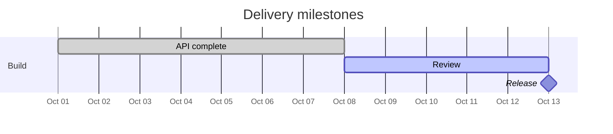

A `gantt` diagram places tasks on a time axis. Give the first task a date; subsequent tasks can start after another task ends. This schedule renders through the CLI, WASM, Markdown and Astro integrations:

The API task ends on October 8. `after api` starts Review at that boundary, and Review ends on October 13. The zero-duration Release appears as a diamond on October 13. A milestone with a nonzero duration sits halfway between its start and end, following Mermaid's convention.

## Schedule tasks

The text before `:` is the visible label. The fields after it contain optional flags, an optional task ID, a start, and an end or duration. IDs let other tasks refer to a task without repeating its dates.

| Task fields | Meaning |
|---|---|
| `api, 2026-10-01, 7d` | An explicit start and duration, with ID `api` |
| `review, after api, 5d` | Starts when `api` ends |
| `after api review, 2d` | Starts at the latest end of both dependencies |
| `2026-10-01, 2026-10-08` | Explicit start and end |
| `3d` | Starts at the previous task's end, including across sections |

`until taskId` uses another task's start as the end boundary. Missing IDs, dependency cycles and ends before starts produce source-located errors. They never substitute the current date.

The flags `done`, `active` and `crit` give task bars distinct theme roles. `milestone` draws a diamond; `vert` draws a vertical marker. Section headings group tasks. Durations accept `ms`, `s`, `m`, `h`, `d`, `w`, `M` and `y`; `M` means calendar months and `m` means minutes.

## Calendar and axis

`excludes weekends` extends duration-based tasks over excluded dates. Explicit start/end dates keep their stated boundaries. `includes YYYY-MM-DD` overrides an exclusion on that date. The [Gantt contract](/reference/specs/gantt/) lists supported formats, calendar rules, axis directives and configuration keys.

All scheduling uses UTC. Full dates remain independent of the machine's time zone and clock. Time-only and incomplete dates use the Unix epoch as a neutral calendar origin and produce an informational diagnostic. A first task without a start is an error. The clock-dependent today marker is omitted; `todayMarker off` states that choice in portable Mermaid source.

Task labels occupy a measured column beside the timeline. Axis labels use measured spacing. An explicit `tickInterval` preserves its requested interval and can increase the diagram's intrinsic width. When it would require more than 512 ticks, the axis uses an aligned multiple and reports the coarser cadence with `I039`; task dates stay unchanged. `<merlion-view>` provides pan and zoom when the chart is wider than its container. `topAxis` adds a top axis. `displayMode compact` shares a row only when both the bars and their labels fit.

## SVG and accessibility

The output contains SVG text and shapes with the same CSS tokens as other Merlion diagrams. It has a title and a generated text alternative listing sections, task dates and statuses. The Markdown plugin uses `accTitle`, then the Gantt `title`, then a front-matter title for its caption.

Gantt tasks carry schedule metadata for downstream tools; they have no task-details popover. See the [Gantt contract](/reference/specs/gantt/) for the attributes and the [viewer guide](/guides/viewer/) for pan and zoom.

Mermaid's complete language reference is the [official Gantt documentation](https://mermaid.js.org/syntax/gantt.html). Unsupported source syntax produces a diagnostic instead of an alternate schedule.
