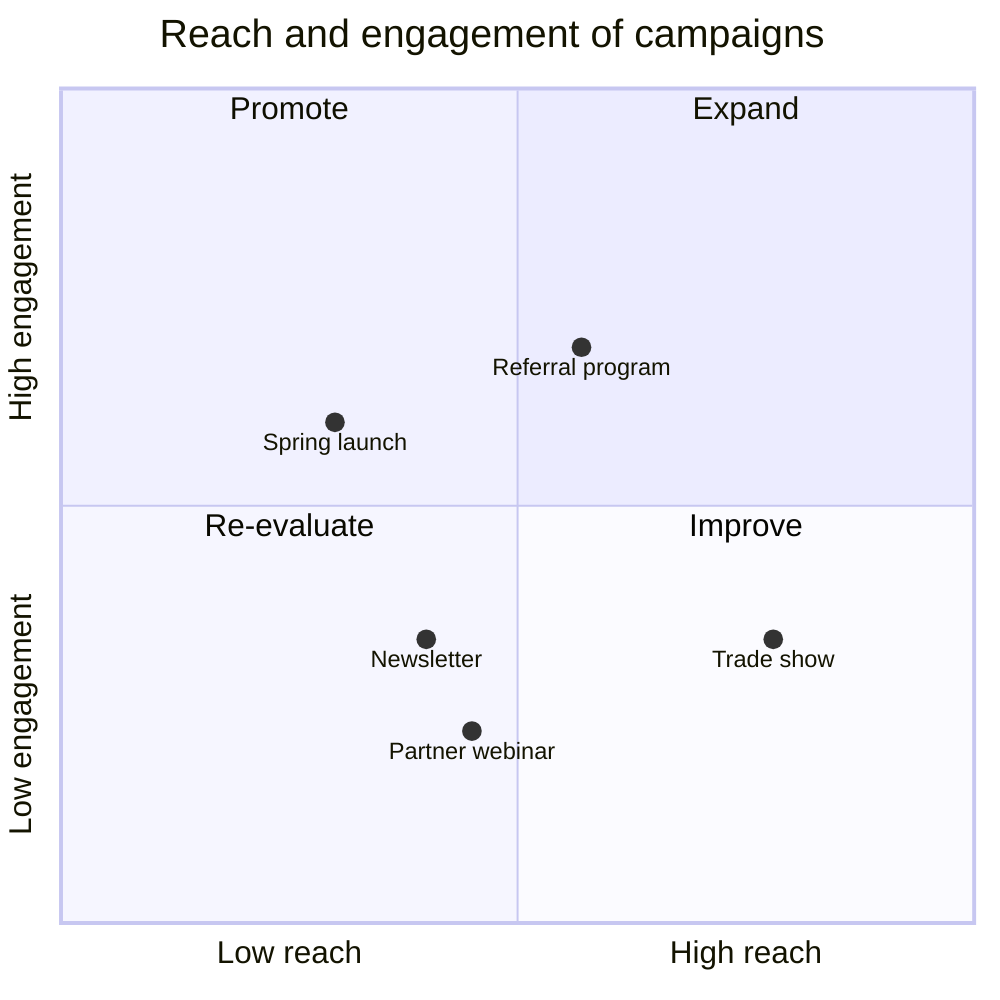
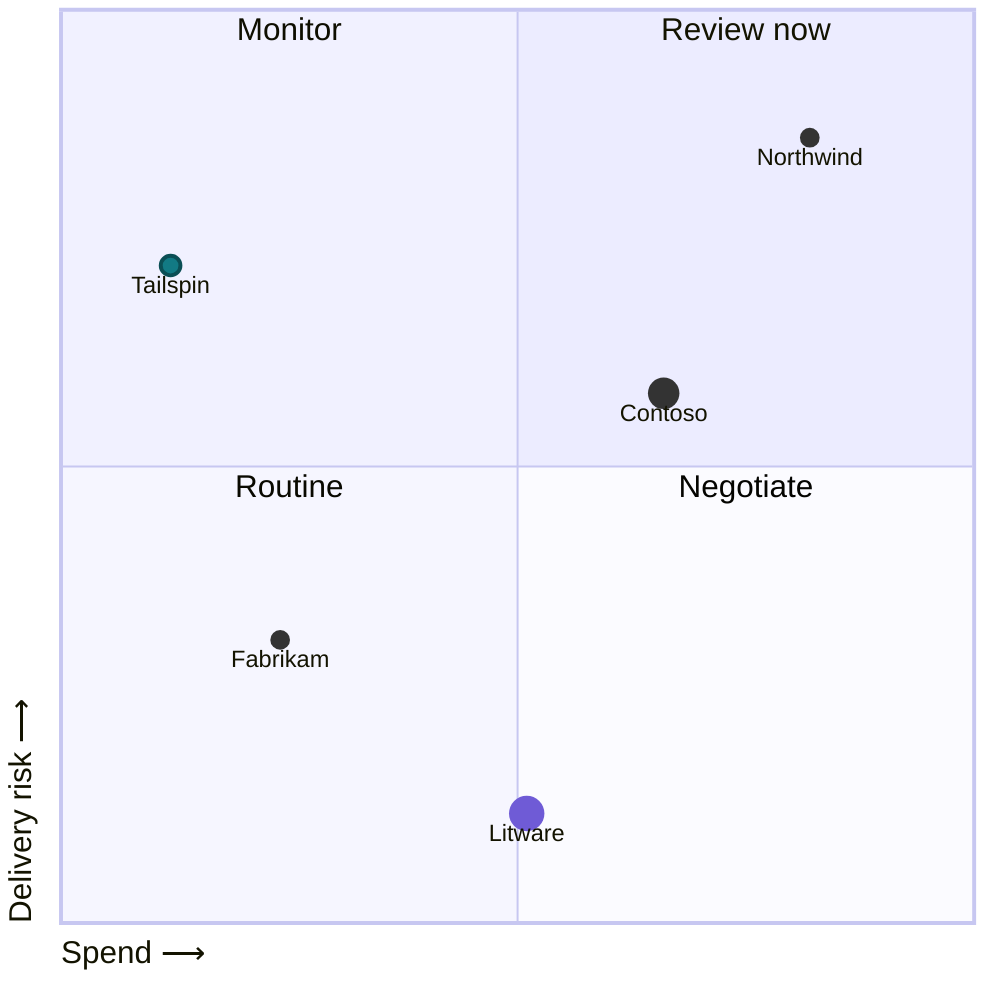

A `quadrantChart` splits a square into four labelled quadrants and places points by two coordinates from 0 to 1. This chart renders through the CLI, WASM, Markdown and Astro integrations:

## Statements

| Statement | Draws |
|---|---|
| `title <text>` | A title above the chart |
| `x-axis <left> --> <right>` | Labels at the two ends of the x-axis; `x-axis <left>` labels the left end alone, and `x-axis <left> -->` adds an arrow |
| `y-axis <bottom> --> <top>` | The same for the y-axis, bottom first |
| `quadrant-1 <text>` … `quadrant-4 <text>` | Quadrant labels: 1 top right, 2 top left, 3 bottom left, 4 bottom right |
| `<name>: [x, y]` | A point; `x` runs left to right and `y` bottom to top, each from 0 to 1 |
| `<name>:::<class>: [x, y]` | A point with a class |
| `classDef <class> <styles>` | Point styles shared by a class |

Keywords match in any case. A text in double quotes may hold `:`, `-->` and brackets. Statements end at a line break or at `;`. Mermaid moves the x-axis labels below the chart, and the quadrant labels to the top of their quadrants, whenever the chart has points; Merlion places them the same way.

A coordinate outside 0–1 fails with `E024` at its position. A coordinate in range that mermaid's lexer cannot read, such as `1.0` or `.5`, is rewritten to `1` or `0.5` with the `R021` repair, so `merlion check --fix` makes the source portable. Any other statement fails with `E002`, naming the statements the parser expected.

## Point styles

A point takes `radius`, `color`, `stroke-color` and `stroke-width` after its coordinates, or from its class. A point's own style wins over its class's style, which wins over the theme:

A class that no `classDef` declares is a role. The tone roles `accent`, `ok`, `warn`, `danger`, `muted` and `store` colour a point with their theme tone, and a stylesheet can tone any other role, as on a flowchart node ([Roles and stylesheets](/guides/roles-and-stylesheets/)). A `classDef` colour reads `--merlion-c-{class}-fill` and `--merlion-c-{class}-stroke`, so a page can re-theme the class. A style outside the four properties or their values is dropped with `W010`.

## Configuration and theme

`config.quadrantChart` sets the chart's width and height (500 × 500 by default), paddings, font sizes, border widths, the default point radius, and the axis positions `xAxisPosition` (`top`, `bottom`) and `yAxisPosition` (`left`, `right`). A container narrower than the chart narrows it. The quadrant colours of `themeVariables` (`quadrant1Fill`, `quadrantPointFill` and the rest) are fixed colours that override the theme, reported with `I030`; other theme variables are ignored, because Merlion themes are CSS.

With no configuration, the quadrants are the accent mixed into the background at four strengths, the points take the accent, and the text and borders take the foreground and border tokens. Light, dark and named themes restyle the chart through CSS alone ([Theming](/guides/theming/)).

## SVG and accessibility

Each point is a group carrying `data-merlion-id` (its name), `data-merlion-x` and `data-merlion-y`, with a `<title>` tooltip. The SVG's text alternative lists the axes, the quadrant labels and every point with its coordinates and quadrant. The Markdown plugin uses `accTitle`, then the chart `title`, then a front-matter title for its caption.

The [quadrant chart contract](/reference/specs/quadrant/) records the layout, the SVG classes and where the output differs from mermaid's. Mermaid's language reference is the [official quadrant chart documentation](https://mermaid.js.org/syntax/quadrantChart.html).
